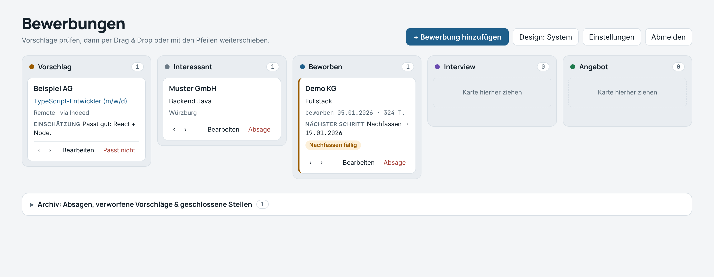
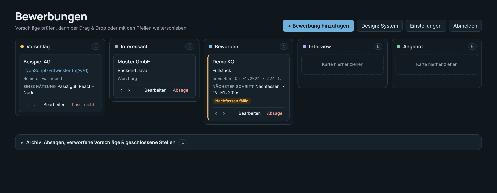
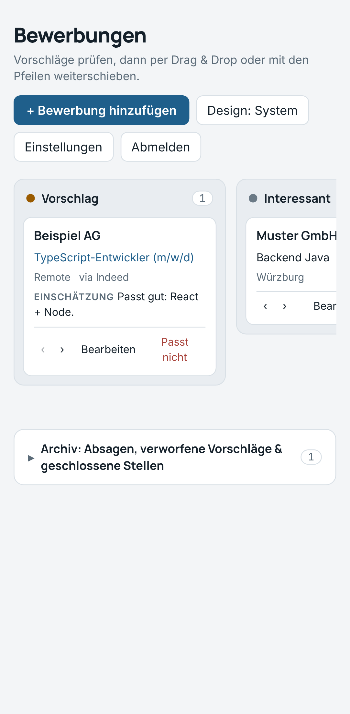
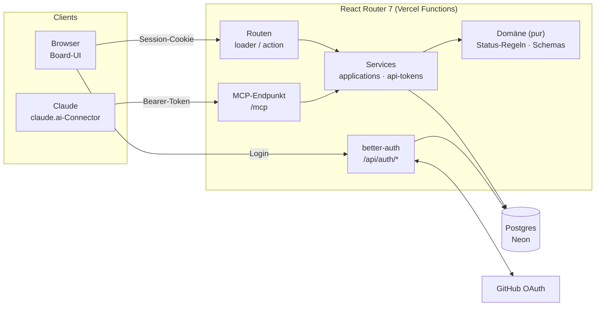

# Jobwerk

Das Werkzeug für die Jobsuche: ein persönliches Bewerbungs-Board (Kanban) mit GitHub-Login und eigenem
**MCP-Server**, über den Claude Stellenvorschläge eintragen und Bewerbungen aktualisieren kann.



<details>
<summary>Dunkles Design und Mobilansicht</summary>





</details>

> Screenshots zeigen erfundene Beispieldaten.

## Funktionen

- **Board** mit den Spalten Vorschlag → Interessant → Beworben → Interview → Angebot, horizontal scrollbar
- Karten verschieben per **Drag & Drop** (Maus, Touch und Tastatur) oder per Pfeil-Buttons
- **Regeln beim Statuswechsel**: erster Wechsel nach „Beworben“ setzt Datum (heute) und Nachfass-Termin (+14 Tage);
  Archiv-Status merken sich die vorherige Spalte für „Zurückholen“
- „Passt nicht“ auf Vorschlägen mit optionalem Grund – die Gründe fließen als Signal zurück in die tägliche Suche
- **Rückgängig**-Toast nach jeder Statusänderung, optimistische UI
- „Nachfassen fällig“-Markierung, Light/Dark Mode, mobil nutzbar
- **MCP-Server** (Streamable HTTP) mit Tools für Claude, abgesichert per persönlichem API-Token

## Tech-Stack

| Bereich      | Wahl                                                                |
| ------------ | ------------------------------------------------------------------- |
| Sprache      | TypeScript (strict), Node 22                                        |
| Web          | React Router 7 (Framework-Modus, SSR), React 19, Tailwind CSS 4     |
| Drag & Drop  | dnd-kit (Pointer-, Touch- und Keyboard-Sensor, deutsche Ansagen)    |
| Datenbank    | PostgreSQL (Neon serverless) + Drizzle ORM, Migrationen per Kit     |
| Auth         | better-auth mit GitHub OAuth, Allowlist auf GitHub-Logins           |
| KI-Anbindung | `@modelcontextprotocol/sdk`, Streamable HTTP, zustandslos           |
| Validierung  | Zod – gemeinsame Schemas für Formulare und MCP-Tools                |
| Tests        | Vitest + PGlite (echtes Postgres im Speicher), Playwright (E2E)     |
| CI/CD        | GitHub Actions (Format, Lint, Typecheck, Tests, Build, E2E), Vercel |

## Architektur



**Leitidee:** Board und MCP-Server teilen sich **eine** Service-Schicht und **eine** pure Domänenlogik
(`app/domain/`). Ob eine Karte per Drag & Drop oder von Claude per `move_application` verschoben wird – es gelten
dieselben Regeln (`planMove`). Die Domäne hat keine Abhängigkeiten auf DB oder Framework und ist vollständig
unit-getestet; die Services bekommen die Datenbank als Parameter und laufen in Tests gegen PGlite statt gegen Mocks.

```
app/
├── domain/        Status-Modell, Regeln (planMove, isFollowUpDue), Zod-Schemas – pur, ohne I/O
├── db/            Drizzle-Schema und DB-Client (Neon HTTP in Prod, node-postgres lokal)
├── services/      Anwendungsfälle mit DB-Zugriff, gemeinsam für Board und MCP
├── mcp/           MCP-Server (Tools) und HTTP-Handler mit Token-Prüfung
├── lib/           Auth (better-auth + Allowlist), Theme-Cookie
├── components/    Board-UI (Spalten, Karten, Editor, Archiv, Undo-Toast)
└── routes/        Board, Login, Einstellungen, /api/auth/*, /mcp
drizzle/           SQL-Migrationen
scripts/           Seed-Import aus dem alten Tracker
e2e/               Playwright-Tests inkl. Login ohne GitHub (test-only better-auth-Instanz)
```

### Sicherheit

- Login nur über GitHub; `ALLOWED_GITHUB_LOGINS` wird beim Login **und** bei jedem Request geprüft.
  Fremde Accounts werden gar nicht erst angelegt.
- MCP-Tokens werden nur als SHA-256-Hash gespeichert, einmalig angezeigt und sind widerrufbar.
  Auch der Token-Besitzer muss auf der Allowlist stehen.
- Redirects nach dem Login nur auf relative Pfade (kein Open Redirect).
- Personenbezogene Seed-Daten liegen in `seed/` und sind per `.gitignore` vom Repo ausgeschlossen;
  Tests und Screenshots verwenden nur erfundene Daten.

## MCP-Tools

| Tool                     | Zweck                                                                  |
| ------------------------ | ---------------------------------------------------------------------- |
| `list_applications`      | Bewerbungen (kompakt), optional nach Status gefiltert                  |
| `get_application`        | Alle Felder einer Bewerbung                                            |
| `add_suggestion`         | Neuer Vorschlag; erkennt Duplikate (gleicher Link oder Firma + Stelle) |
| `update_application`     | Felder ändern (Status nur über `move_application`)                     |
| `move_application`       | Statuswechsel nach den Board-Regeln, optional mit Grund                |
| `list_rejection_reasons` | Gründe verworfener Vorschläge – Signal für bessere Vorschläge          |

Token unter **Einstellungen** erstellen, dann z. B. mit dem MCP Inspector testen:

```sh
npx @modelcontextprotocol/inspector
# Transport: Streamable HTTP, URL: http://localhost:5173/mcp
# Header: Authorization: Bearer jw_…
```

## Lokal entwickeln

Voraussetzungen: Node 22 und ein Postgres (lokal oder ein Neon-Branch).

```sh
npm install
cp .env.example .env          # Werte eintragen (GitHub-OAuth-App: Callback /api/auth/callback/github)
npm run db:migrate
npm run db:seed               # optional: Import aus seed/bewerbungen.json (nicht im Repo)
npm run dev                   # http://localhost:5173
```

| Skript                | Zweck                                         |
| --------------------- | --------------------------------------------- |
| `npm test`            | Unit- und Integrationstests (Vitest + PGlite) |
| `npm run test:e2e`    | Playwright gegen einen Produktions-Build      |
| `npm run lint`        | ESLint                                        |
| `npm run typecheck`   | Route-Typen generieren + `tsc`                |
| `npm run db:generate` | Migration aus Schema-Änderungen erzeugen      |

E2E-Tests brauchen eine Postgres-Datenbank (`E2E_DATABASE_URL`, Standard
`postgres://postgres@localhost:5433/jobwerk_e2e`). Den Login übernimmt eine test-only better-auth-Instanz,
die eine echte, signierte Session erzeugt – die App selbst enthält keinen Test-Bypass.

## Deployment (Vercel + Neon)

1. Neon-Projekt anlegen, `DATABASE_URL` setzen, `npm run db:migrate` gegen die Neon-DB ausführen.
2. GitHub-OAuth-App mit Callback `https://<domain>/api/auth/callback/github` anlegen.
3. Vercel-Projekt verbinden und die Variablen aus `.env.example` setzen (`BETTER_AUTH_URL` = Produktions-URL).
   Das Vercel-Preset für React Router wird beim Build automatisch aktiviert.

## Status

Erste Version: Board, Login, MCP-Server mit Token-Auth, Tests und CI. Nächste Schritte siehe
[docs/PROJECT_BRIEF.md](docs/PROJECT_BRIEF.md) – vor allem OAuth für den MCP-Server (claude.ai-Connector),
Deployment und eine Status-Historie.
